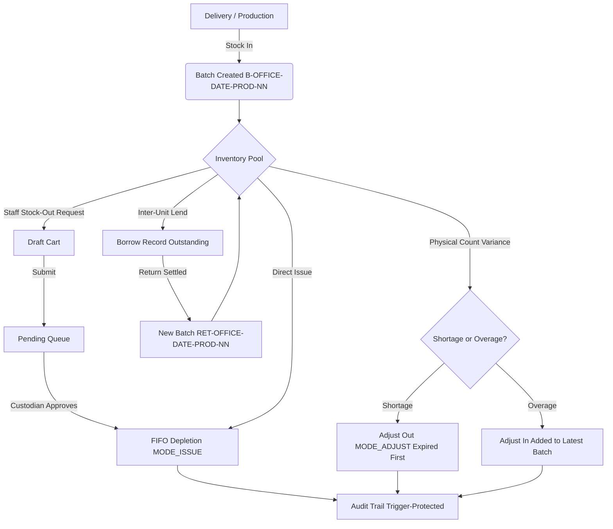
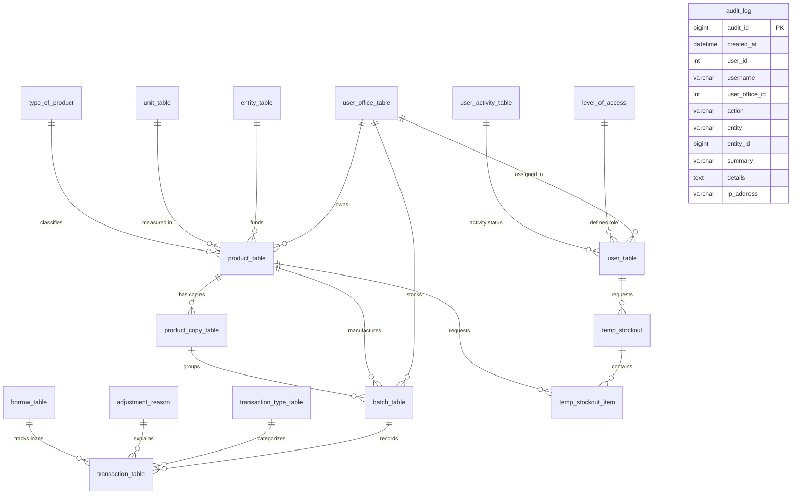

# BSU Integrated Inventory Monitoring System

[](https://github.com/ElliciaRuth/Inventory-system)
[](https://github.com/ElliciaRuth/Inventory-system)
[](https://www.php.net/)
[](https://codeigniter.com/)
[](https://vuejs.org/)
[](https://vitejs.dev/)

> **Current Version:** `v2.7.0` (Production Release — October 2026)

An integrated inventory, stock-card, and stock-out monitoring system engineered specifically for Benguet State University (BSU) production and operating units, including the **Bakery Project**, the **Food Processing Center (FPC)**, and administrative offices.

The application is structured as a decoupled web application comprising a **CodeIgniter 4 JSON REST API** backend and a responsive **Vue 3 single-page application (SPA)** frontend. It runs over local office area networks (LAN / Wi-Fi) without an internet connection (only outgoing email, used for password-reset and verification codes, needs internet access), providing enterprise-grade stock tracking, automated First-In, First-Out (FIFO) batch allocation, government Appendix 58 stock card compliance, tamper-evident audit trails, and modular disaster recovery.

```
BSU_Inventory_System/
├── backend/          CodeIgniter 4 JSON REST API (all endpoints under /api)
│   ├── app/          Controllers, Models, Services, Libraries, Config, Filters, Database
│   ├── public/       Front controller (index.php), generated barcode SVGs (/barcodes), summary report logos (/report-logos)
│   ├── writable/     Cache, logs, session data, safety backup archives
│   └── spark         CodeIgniter CLI tool (migrations, seeds, password reset CLI)
├── frontend/         Vue 3.5 + Vite single-page application
│   ├── src/          Views, components, router, Pinia stores, API clients, styles
│   └── dist/         Pre-compiled production distribution served by web server
├── deploy/           Automated offline installation, Apache SSL configs, local CA scripts
├── docker/           Container definitions (PHP 8.2-FPM, Nginx, MariaDB)
├── docker-compose.yml Containerized stack launcher
├── setup.bat         Windows launcher (Default: Offline HTTPS; --dev: Dev servers; --prepare: USB packaging)
├── setup.ps1         Windows PowerShell stack management script
├── setup.sh          Linux / macOS / WSL automated setup script
└── release.ps1       Sets a new release version everywhere (optionally tags it and builds the installer)
```

---

## Table of Contents

1. [User Roles & Permissions Matrix](#1-user-roles--permissions-matrix)
2. [Complete System Business Logics & Algorithms](#2-complete-system-business-logics--algorithms)
   - [2.1 First-In, First-Out (FIFO) & Batch Depletion Logic](#21-first-in-first-out-fifo--batch-depletion-logic)
   - [2.2 Sub-Products & Price Variants Architecture (Product Copies)](#22-sub-products--price-variants-architecture-product-copies)
   - [2.3 Stock Movement Lifecycle & State Machines](#23-stock-movement-lifecycle--state-machines)
   - [2.4 Stockcard Running Balance Calculation (Window Function)](#24-stockcard-running-balance-calculation-window-function)
   - [2.5 Physical Inventory Count & Variance Reconciliation](#25-physical-inventory-count--variance-reconciliation)
   - [2.6 Staff Stock-Out Request, Drafting & Approval Lifecycle](#26-staff-stock-out-request-drafting--approval-lifecycle)
   - [2.7 Appendix 58 Excel Stockcard Parsing & Clean Import Engine](#27-appendix-58-excel-stockcard-parsing--clean-import-engine)
   - [2.8 Modular & Cryptographically Encrypted Backup System](#28-modular--cryptographically-encrypted-backup-system)
   - [2.9 Barcode Generation, Code 128 / Code 39 Formatting & Scanner Integration](#29-barcode-generation-code-128--code-39-formatting--scanner-integration)
   - [2.10 Authentication, Session Security & Brute-Force Lockout Engine](#210-authentication-session-security--brute-force-lockout-engine)
   - [2.11 Self-Service Password Reset via System SMTP & Email OTP](#211-self-service-password-reset-via-system-smtp--email-otp)
   - [2.12 Tamper-Evident Append-Only Audit Trail & Database Triggers](#212-tamper-evident-append-only-audit-trail--database-triggers)
   - [2.13 Product Catalog Archiving, Validation Guardrails & Restoration](#213-product-catalog-archiving-validation-guardrails--restoration)
   - [2.14 Real-Time Notification & Expiration Alert Engine](#214-real-time-notification--expiration-alert-engine)
   - [2.15 Decimal Precision, Financial Rounding & Report Cost Overrides](#215-decimal-precision-financial-rounding--report-cost-overrides)
   - [2.16 Multi-Tenant Office Segregation & Administrator Protection](#216-multi-tenant-office-segregation--administrator-protection)
   - [2.17 Multi-Format Export Engine & CSV Formula Injection Protection](#217-multi-format-export-engine--csv-formula-injection-protection)
3. [Installation & Deployment](#3-installation--deployment)
   - [Windows Installer (Recommended for the Office PC)](#windows-installer)
   - [Option C: Offline HTTPS Server on XAMPP](#option-c-offline-https-server-on-xampp)
   - [Option A: Docker Deployment (Single-Command Docker Compose)](#option-a-docker-deployment)
   - [Option B: Development Mode (XAMPP / PHP 8.2 + Vite Dev Server)](#option-b-development-mode-without-docker)
   - [Default Accounts & Credentials](#default-accounts--credentials)
   - [Connecting Other Computers, Tablets, and Phones](#connecting-other-computers-tablets-and-phones)
   - [Installing the Local Root CA Certificate on Client Devices](#installing-the-local-root-certificate-on-client-devices)
4. [Day-to-Day Operations & Operational Workflows](#4-day-to-day-operations--operational-workflows)
5. [Security Architecture & Guardrails](#5-security-architecture--guardrails)
6. [Database Schema Overview](#6-database-schema-overview)
7. [API Reference](#7-api-reference)
8. [Troubleshooting & Maintenance](#8-troubleshooting--maintenance)
9. [Version History & Changelog](#9-version-history--changelog)

---

## 1. User Roles & Permissions Matrix

The system enforces strict Role-Based Access Control (RBAC) partitioned by office assignment (`user_office_id`).

### Permissions Matrix

| Module / Feature | Staff (Level 1) | Custodian (Level 2) | Manager (Level 3) | Technical Staff (Level 4) |
|---|:---:|:---:|:---:|:---:|
| **Dashboard KPI Overview** | View Own | View Office | View Office | View System |
| **Product Catalog (Read)** | Yes | Yes | Yes | No (Hidden) |
| **Product Catalog (Create/Edit/Delete)** | No | Yes | Yes | No |
| **Product Archiving & Restoration** | No | Yes | Yes | No |
| **Stock-Out Request (Draft & Submit)** | Yes | Yes | Yes | No |
| **My Stock-Out List & History** | Yes | Yes | Yes | No |
| **Approve / Reject Stock-Out Requests** | No | Yes | Yes | No |
| **Stockcard Ledger (View)** | No | Yes | Yes | No |
| **Stockcard Ledger (Stock In / Issue / Adjust)** | No | Yes | Yes | No |
| **Edit Mode: correct Stock Card & Summary Report cells** | No | Yes | Yes | No |
| **Inter-Unit Borrowing & Returns** | No | Yes | Yes | No |
| **Physical Inventory Count & Reconciliation** | No | Yes | Yes | No |
| **Reports (Batch Inventory, Summary)** | No | Yes | Yes | No |
| **Export (PDF, Word, CSV / Excel)** | No | Yes | Yes | No |
| **Barcode Generation & SVG Download** | Read/Lookup | Generate & View | Generate & View | No |
| **Import Appendix 58 from Excel (Keep Mode)** | No | Yes | Yes | No |
| **Import Appendix 58 (Replace Mode / Wipe)** | No | With an office manager's password | Yes (own password required) | No |
| **Office Settings (Entities, Units, Types)** | No | No | Yes | No |
| **Office User Management (Activate/Deactivate)** | No | No | Yes (Office Users) | Yes (Global Users) |
| **Edit User Accounts (name, username, role, office, temporary password)** | No | No | No | Yes |
| **System Settings (Expiry Thresholds)** | No | View Only | Yes | No |
| **Report Signatories (Prepared / Verified / Noted by)** | No | No | Yes (own office) | No |
| **Data Backup & Restore** | No | Auto-Backup on Login | Full Create / Restore | No |
| **Audit Trail (Audit Log)** | No | No | Office Scope | Global Scope (All Offices) |
| **System Administration & Office Setup** | No | No | No | Yes |
| **Edit Own Profile & Change Password** | Yes | Yes | Yes | Yes |

> The matrix describes what each role sees in the app. The backend route filters are minimum levels (`level:N` means level N or higher), so the "No" entries for Technical Staff are enforced by the frontend router (`maxLevel: 3`), not by the API.

### Account Lifecycle & Authentication Safeguards
- **Self-Registration:** New users register with their requested role and office. Accounts are held in `user_activity_id = 3` (Pending) until approved by an Office Manager or Technical Staff.
- **Administrative Protection:** Technical Staff (Level 4) accounts are permanently protected by backend filters: they **cannot be deactivated, declined, or deleted** via any API endpoint or UI action.
- **Account Changes:** Office Managers activate, deactivate and decline the accounts of their office but cannot change them. Name, username, role, office and temporary passwords are changed only by Technical Staff (`POST api/settings/users` answers `403` below level 4). A user locked out without email access asks Technical Staff for a temporary password (or see *Resetting Forgotten Passwords via Spark CLI*).
- **First-Login Wizard (`/account-setup`):** Accounts flagged with `must_change_password` or `must_setup_smtp` (Technical Staff) are strictly prevented from visiting any operational inventory routes until the required setup steps are fully completed.

---

## 2. Complete System Business Logics & Algorithms

This section documents every mathematical calculation, business rule, algorithmic flow, and data integrity constraint implemented in the system.



---

### 2.1 First-In, First-Out (FIFO) & Batch Depletion Logic
**Location:** [`backend/app/Services/InventoryService.php`](file:///c:/xampp/htdocs/BSU_Inventory_System/backend/app/Services/InventoryService.php)

The system enforces automated batch selection across all outgoing inventory movements (manual issues, approved staff requests, and borrowing).

#### 1. Depletion Modes (`planDepletion`)
- **`MODE_ISSUE` (Standard Issuance & Staff Stock-Out):**
  - Selects only batches where `current_qty > 0` AND (`expiration_date IS NULL` OR `expiration_date >= CURDATE()`).
  - Strict FIFO sort order:
    $$\text{Primary Sort: } \text{date\_received ASC} \quad \longrightarrow \quad \text{Tie-Breaker: } \text{batch\_id ASC}$$
  - **Expired Batch Lockout:** Batches past their expiration date are strictly forbidden from normal issuance. If the unexpired stock is not enough, the system aborts with the usable quantity and, when expired batches exist, the expired quantity that must be cleared via Adjust Out.
- **`MODE_ADJUST` (Shortages & Inventory Adjustments):**
  - Prioritizes expired stock for removal before consuming good stock:
    $$\text{Primary Sort: } \text{is\_expired DESC} \quad \longrightarrow \quad \text{Secondary Sort: } \text{date\_received ASC} \quad \longrightarrow \quad \text{batch\_id ASC}$$
- **`MODE_EXPIRED`:**
  - Isolates strictly expired batches (`expiration_date < CURDATE()`), oldest received first.

#### 2. Allocation Algorithm
For a requested depletion quantity $Q_{\text{req}}$:
1. Initialize remaining quantity $R = Q_{\text{req}}$.
2. Iterate through sorted batches:
   $$\text{Take Quantity } T_i = \min(\text{Batch } i.\text{current\_qty}, \max(0, R))$$
   $$\text{Batch } i.\text{new\_qty} = \text{Batch } i.\text{current\_qty} - T_i$$
   $$R \leftarrow R - T_i$$
3. If $R > 0$ after checking all eligible batches, throw a `DomainException` indicating the exact shortfall ($R$) and usable stock.
4. If $R = 0$, execute the database updates inside a transaction:
   - Decrement `batch_table.current_qty` by $T_i$.
   - Insert an individual `transaction_table` ledger entry for each allocated batch. Issues and lends record the unit cost entered for the movement; adjustments (Adjust Out, physical-count shortages) record each batch's own acquisition cost.

#### 3. Real-Time Batch Plan Preview
Before confirming a transaction in the browser, the frontend calls `GET /api/stock/batch-plan` to simulate allocation, showing the custodian exactly which batch numbers, expiration dates, and quantities will be deducted.

---

### 2.2 Sub-Products & Price Variants Architecture (Product Copies)
**Location:** [`backend/app/Models/ProductCopyModel.php`](file:///c:/xampp/htdocs/BSU_Inventory_System/backend/app/Models/ProductCopyModel.php)

Government accounting rules require tracking inventory that shares a common item specification but is procured across fluctuating unit prices over time (e.g., *Bread Flour @ ₱45.00/kg* vs *Bread Flour @ ₱52.50/kg*).

- **Tolerance Matching:** When recording a Stock-In, the system evaluates:
  $$|\text{new\_unit\_cost} - \text{existing\_unit\_cost}| < 0.005$$
- **Automatic Copy Provisioning:**
  - If a copy matches within the ₱0.005 threshold, the incoming batch is linked to that existing `copy_id`.
  - If no match exists, a new `product_copy_table` record is auto-generated and labeled sequentially (`Copy 2`, `Copy 3`, etc.).
- **Inventory Isolation:** Stock counts are tracked independently per copy while rolling up to the parent product's master stockcard.

---

### 2.3 Stock Movement Lifecycle & State Machines
**Location:** [`backend/app/Services/InventoryService.php`](file:///c:/xampp/htdocs/BSU_Inventory_System/backend/app/Services/InventoryService.php)

The system handles six core stock transaction types:

```
[Receipt (Stock In)] ────> Creates New Batch ────> current_qty = Qty ────> Increases Stock
[Issue (Stock Out)]  ────> FIFO Depletion   ────> Decrements Batches ────> Decreases Stock
[Borrow (Lend Out)]  ────> FIFO Depletion   ────> borrow_table Created ──> Status: outstanding
[Return (Settlement)]───> Creates RET Batch ────> Decrements Borrow  ───> Status: partial / returned
[Adjust Out]         ────> Expired First    ────> Decrements Batches ────> Reason Required
[Adjust In]          ────> Adds to Newest   ────> Increments Batch   ────> Reason Required
```

1. **Receipt (`receipt` / Stock In):**
   - Validates that `unit_cost >= 0`, `mfg_date <= transaction_date <= CURDATE()`, and `mfg_date <= expiration_date`.
   - Generates a unique batch number formatted as:
     $$\text{B}-\{\text{OFFICE}\}-\{\text{YYYYMMDD}\}-\{\text{PRODUCT\_ID}\}-\{\text{INDEX}\}$$
   - Generates a unique Code 128 barcode value and vector SVG.
   - Inserts the receipt transaction entry and increments inventory.
2. **Issue (`issue` / Stock Out):**
   - Deducts stock using `MODE_ISSUE` (FIFO unexpired).
   - Supports a usage percentage (whole number, clamped to 1–100, default 100):
     $$\text{Effective Quantity} = \text{Quantity} \times \left(\frac{\text{Usage Percentage}}{100}\right)$$
3. **Borrow (`borrow` / Lend Out):**
   - Logs recipient borrower name (min 2 chars), borrowing office (one of the user offices, or free text), and an optional due date.
   - Enforces that the borrowing unit cannot be the lending office.
   - Depletes stock using FIFO and inserts a record in `borrow_table` with `status = 'outstanding'`.
4. **Return (`return` / Borrow Settlement):**
   - Validates that returned quantity does not exceed the remaining outstanding balance:
     $$\text{Outstanding Balance} = \text{borrow\_table.quantity} - \text{borrow\_table.returned\_qty}$$
   - Creates a dedicated return batch prefixed as:
     $$\text{RET}-\{\text{OFFICE}\}-\{\text{YYYYMMDD}\}-\{\text{PRODUCT\_ID}\}-\{\text{INDEX}\}$$
   - Increments `borrow_table.returned_qty`. If $\text{returned\_qty} \ge \text{quantity}$, marks status as `'returned'` and stamps `returned_at`; otherwise marks `'partial'`.
5. **Adjust Out (`adjust_out`):**
   - Consumes stock using `MODE_ADJUST` (expired batches first).
   - Requires an adjustment reason from `AdjustmentReasonModel::ADJUST_OUT` (*Spoiled, Damaged, Correction, Others*). The *Physical Count* reason is reserved for count reconciliation (section 2.5).
   - Values outgoing deductions at each batch's actual acquisition cost.
6. **Adjust In (`adjust_in`):**
   - Requires an adjustment reason from `AdjustmentReasonModel::ADJUST_IN` (*Wrong Count, Others*).
   - Adds quantity to the newest unexpired batch of the product variant via `addToLatestBatch()` (the newest batch of any kind if all are expired), valued at that batch's acquisition cost.

---

### 2.4 Stockcard Running Balance Calculation (Window Function)
**Location:** [`backend/app/Models/TransactionModel.php`](file:///c:/xampp/htdocs/BSU_Inventory_System/backend/app/Models/TransactionModel.php)

The system complies with the government Appendix 58 stock card ledger format. Running balances are calculated dynamically using an SQL window function:

$$\text{Running Balance} = \sum_{k=1}^{n} \left( \mathbb{I}_{\text{in}}(k) \cdot Q_k - \mathbb{I}_{\text{out}}(k) \cdot Q_k \right) \quad \text{OVER } (\text{PARTITION BY } \text{product\_id } \text{ORDER BY } \text{date ASC, transaction\_id ASC})$$

Where:
- $\mathbb{I}_{\text{in}} \in \{\text{'receipt'}, \text{'return'}, \text{'adjust\_in'}\}$
- $\mathbb{I}_{\text{out}} \in \{\text{'issue'}, \text{'borrow'}, \text{'adjust\_out'}\}$

#### Split FIFO Multi-Batch Row Consolidation
When a single issuance depletes multiple batches, `depleteBatches()` records individual transaction rows for each batch. The ledger query performs an outer aggregation grouping by `(date, transaction_type_id, office, reference, copy)` to display a single unified line with `SUM(issue_qty)` and, as the line's balance, the running balance after the group's last entry (highest `transaction_id`).

#### Transaction Editing & Deletion Reversal Logic
When editing or deleting past transactions:
- **Undo Original Movement:**
  - If original was Stock-In: $\text{Current Batch Qty} - Q_{\text{old}}$
  - If original was Stock-Out: $\text{Current Batch Qty} + Q_{\text{old}}$
- **Apply New Movement:**
  - Validates that reversing the transaction does not cause the linked batch's stock to drop below zero:
    $$\text{New Batch Qty} \ge 0$$
  - If units from that batch have already been consumed by subsequent issuances, the mutation is blocked with an error.
  - Transactions linked to borrow records cannot be edited or deleted (returns must be recorded instead).

---

### 2.5 Physical Inventory Count & Variance Reconciliation
**Location:** [`backend/app/Services/InventoryService.php`](file:///c:/xampp/htdocs/BSU_Inventory_System/backend/app/Services/InventoryService.php), [`backend/app/Controllers/Api/StockController.php`](file:///c:/xampp/htdocs/BSU_Inventory_System/backend/app/Controllers/Api/StockController.php)

Custodians count shelf stock on `/stock/count`. The reconciler resolves variances automatically:

$$\text{Variance} = \text{Counted Quantity} - \text{System Book Balance}$$

- **Zero Variance ($|\text{Variance}| < 0.0001$):** Ignored; no ledger entries generated.
- **Shortage ($\text{Variance} < 0$):**
  - Triggers automated `depleteBatches()` with quantity $|\text{Variance}|$ under `MODE_ADJUST` (expired batches depleted first).
  - Recorded as `adjust_out` with reason `"Physical Count"`.
- **Overage ($\text{Variance} > 0$):**
  - Triggers automated `addToLatestBatch()` with quantity $\text{Variance}$.
  - Recorded as `adjust_in` with reason `"Physical Count"`.
- **Session Reference:** All offsetting entries created during the reconciliation session share a unified reference string:
  $$\text{COUNT}-\{\text{YYYYMMDD}\}-\{\text{His}\}$$

---

### 2.6 Staff Stock-Out Request, Drafting & Approval Lifecycle
**Location:** [`backend/app/Models/StockoutModel.php`](file:///c:/xampp/htdocs/BSU_Inventory_System/backend/app/Models/StockoutModel.php), [`backend/app/Controllers/Api/StockoutController.php`](file:///c:/xampp/htdocs/BSU_Inventory_System/backend/app/Controllers/Api/StockoutController.php)

```
[Staff Adds Items] ───> temp_stockout (draft) ───> Edit / Remove Lines
         │
         ▼
[Submit Request]   ───> Merge Duplicate Lines ───> temp_stockout (pending)
         │
         ▼
[Custodian Review] ───> Modify Quantities (optional)
         ├───> Approve Item ────> FIFO Deducted ───> Status: approved
         ├───> Approve All  ────> Sufficient Stock Only (Skips shortfalls)
         └───> Reject Item  ────> Mandatory Reason Logged ───> Status: rejected
         │
         ▼
[Auto-Finalize]    ───> All items resolved? ────> Header marked approved / rejected
         │
         ▼
[Staff Feed]       ───> 14-Day Notification with Custodian Decision & Feedback
```

1. **Drafting Phase:** Staff build their list in `temp_stockout` (`status = 'draft'`).
2. **Submission & Deduplication:** When submitted, the system scans for identical `product_id:copy_id` pairs, sums their quantities, removes redundant rows, and sets the header to `'pending'`.
3. **Custodian Review & Actions:**
   - **Edit Pending Item:** Custodians can adjust the approved quantity before deciding.
   - **Approve Item:** Verifies non-archived product status and unexpired FIFO availability. Executes FIFO batch deductions and marks item `'approved'`.
   - **Approve All:** Iterates through all pending lines. Items with sufficient unexpired stock are approved; items with insufficient stock are left pending.
   - **Reject Item:** Custodians **must provide an explanatory reason** (up to 500 characters). Marks item `'rejected'` and records decider ID and timestamp.
4. **Header Finalization:** When zero pending lines remain, the header status transitions to `'approved'` (if $\ge 1$ item approved) or `'rejected'` (if all items rejected).
5. **Staff Notifications:** Staff see approval notices or rejection feedback in their notification drawer for 14 days.

---

### 2.7 Appendix 58 Excel Stockcard Parsing & Clean Import Engine
**Location:** [`backend/app/Libraries/StockcardWorkbookParser.php`](file:///c:/xampp/htdocs/BSU_Inventory_System/backend/app/Libraries/StockcardWorkbookParser.php), [`backend/app/Services/StockcardImportService.php`](file:///c:/xampp/htdocs/BSU_Inventory_System/backend/app/Services/StockcardImportService.php)

Imports multi-sheet historical `.xlsx` workbooks adhering to government Appendix 58 specifications.

1. **Card Layout Auto-Discovery:**
   - Detects `stock card` headers across sheets, supporting side-by-side multi-column layouts (columns A–G, I–O, Q–W) and vertically stacked cards down a sheet.
2. **Data Normalization & Spell-Checking:**
   - **Unit Normalization:** Cleans 40+ unit variations to canonical keys using `UNIT_SYNONYMS` (*"kls", "kilos", "kg" $\rightarrow$ `kilo`*; *"pcs", "pieces", "units" $\rightarrow$ `pcs`*; *"btl" $\rightarrow$ `bottle`*; *"pkg", "pk" $\rightarrow$ `pack`*).
   - **Category Detection:** Identifies product categories from tokens in the stock number (e.g., *"FPC RM 01A"*, *"FPC OS-PM 08A"*):
     - `LABEL` / `LBL` $\rightarrow$ Product Label
     - `RM` $\rightarrow$ Raw Materials
     - `OS` / `PM` $\rightarrow$ Other Supplies
     - `FP` $\rightarrow$ Finished Product
     - Otherwise the item name ("label", "sticker") and then the file name decide; the fallback is Raw Materials. Categories can be changed in the preview.
   - **Spelling Correction:** Misspelled words in item names (*"SRAWBERRY" $\rightarrow$ "STRAWBERRY"*) are corrected against the other names in the file and the existing products, using a Levenshtein distance that counts swapped neighbouring letters as one edit.
   - **Carry-Forward Line Elimination:** Automatically detects and skips continuation card headers (*"Balance forwarded"*, *"RPCI count"*, *"FPC RM 19A"*).
3. **Two-Stage Execution:**
   - **Stage 1 (Interactive Preview):** Generates an in-memory plan with a secure 24-hour token. Custodians can inspect beginning balances, transaction rows, and edit cells directly in the preview dialog.
   - **Strict Preview Validation:** `StockcardImportService::issues()` lists everything in the preview that has to be corrected first, each with its card, row and kind: `negative` (negative balances, issues larger than the stock), `missing` (no item name, unit, office or date), `balance` (an Excel balance that doesn't match the entries), `date` (assumed years, missing days, dates earlier than the row before) and `other` (rows skipped or read with a guess, cards not imported). While any remain, the preview shows a red *Cannot proceed with import* banner with a count per kind, highlights the affected products, cards and rows (red for negative/missing, orange for the rest) and locks the Import button; `POST api/import/stockcards/commit` refuses with `422` (and the list in `errors.issues`) before any password is asked. Sheets that are not stock cards at all (no Date / Receipt / Issue / Balance header, or no entries) and automatic spelling fixes don't count.
   - **Stage 2 (Commit):**
     - **Keep Mode:** Appends new transactions. Generates a unique SHA-256 `stock_import_fingerprint` per transaction row, making re-runs idempotent by skipping previously imported lines.
     - **Replace Mode (Wipe):** Requires a manager's password: a manager types their own, a custodian needs the password of an active manager of their office (5 wrong passwords per 15 minutes, then blocked). A backup of each affected office is made first; if it fails, nothing is deleted or imported.

---

### 2.8 Modular & Cryptographically Encrypted Backup System
**Location:** [`backend/app/Services/BackupPackageService.php`](file:///c:/xampp/htdocs/BSU_Inventory_System/backend/app/Services/BackupPackageService.php), [`backend/app/Libraries/BackupCrypto.php`](file:///c:/xampp/htdocs/BSU_Inventory_System/backend/app/Libraries/BackupCrypto.php)

Produces standalone backup archives formatted as standard `.zip` files or encrypted `.bsubackup` containers.

#### Package Contents
- `README.txt`: Plain-text manual restoration instructions.
- `manifest.json`: Metadata, record counts, and individual SHA-256 checksums for every artifact.
- `schema.sql`: Full DDL statements (`CREATE TABLE IF NOT EXISTS`).
- `data.json`: Structured, UTF-8 JSON record dumps table-by-table.
- `spreadsheets/*.csv`: Human-readable CSV tables opening directly in Excel, plus an *Inventory Summary*.
- `barcodes/*.svg`: Vector graphics of all batch barcodes.

#### Encryption Architecture (`.bsubackup`)
- **Key Derivation:** PBKDF2 with HMAC-SHA256, 200,000 iterations, 16-byte random salt.
- **Cipher:** AES-256-GCM with a 12-byte random IV. The file layout is `BSUBAK01` (magic) + salt + IV + 16-byte authentication tag + ciphertext.
- **Tamper Detection:** The GCM authentication tag makes decryption fail if the file was altered, not only when the password is wrong.
- **Password Hash Privacy:** In plain `.zip` backups, password hashes are automatically stripped (`null`) to prevent offline cracking. Password hashes are preserved exclusively in password-encrypted `.bsubackup` files.

#### Pre-Restore Snapshot & Validation
Before executing any restore operation:
1. The package inspector validates manifest integrity, format version, and recalculates SHA-256 hashes for all files. (Checksums only detect damage; every row is still treated as untrusted input.)
2. A full safety backup of the active office database is generated automatically. If it fails, nothing is restored.
3. Missing tables are created from `schema.sql`, foreign-key checks are switched off, and the chosen sections (`setup`, `inventory`, `users`, `settings`; inventory always brings setup with it) are restored inside one database transaction. Foreign keys are checked again at the end.
4. Only managers restore the `settings` section. Accounts that still exist keep their current password; re-created accounts without a trusted password hash (e.g., from a plain `.zip`) get a random password and must reset it.

---

### 2.9 Barcode Generation, Code 128 / Code 39 Formatting & Scanner Integration
**Location:** [`backend/app/Services/BarcodeService.php`](file:///c:/xampp/htdocs/BSU_Inventory_System/backend/app/Services/BarcodeService.php)

- **Finished Products (Code 39):** Rendered as inline SVGs with standard 3:1 wide-to-narrow bar ratios and quiet zones.
- **Manufactured Batches (Code 128):** Generated via `BarcodeGeneratorSVG` and cached in `backend/public/barcodes/`.
  - **Batch Number Format:** `B-{OFFICE}-{YYYYMMDD}-{PRODUCT_ID}-{INDEX}`
  - **Barcode Payload:** `BC-{batchId (padded to 6)}-{YYYYMMDD}-{random 4 hex}`
- **Product Barcode = Stock Code:** A finished product's barcode encodes its stock code (`stock_no`, e.g. `FPC FP 03A`), so every unit of the product carries the same code. It identifies the product only; the batch barcode also identifies the delivery (and so its expiry).
- **Hardware Scanner Support:** Supports standard USB and Bluetooth barcode scanners operating in keyboard-wedge mode (character stream followed by `Enter`), and the camera button in the search boxes.
  - **Batch barcodes** resolve through `GET /api/barcode/lookup` on every scanning page: Record Stock In / Out, the Stock Card item navigator, Physical Count and Request Stock Out.
  - **Product barcodes (stock codes)** are matched against the product list on Record Stock In / Out, the Stock Card item navigator and Physical Count. Request Stock Out does not read them yet (its lookup only knows batch barcodes).

---

### 2.10 Authentication, Session Security & Brute-Force Lockout Engine
**Location:** [`backend/app/Controllers/Api/AuthController.php`](file:///c:/xampp/htdocs/BSU_Inventory_System/backend/app/Controllers/Api/AuthController.php), [`backend/app/Filters/AuthFilter.php`](file:///c:/xampp/htdocs/BSU_Inventory_System/backend/app/Filters/AuthFilter.php)

1. **Password Hashing:** Passwords use PHP native `password_hash()` with `PASSWORD_DEFAULT` (bcrypt, cost 10).
2. **Password Complexity Policy:** Minimum 8 characters, at least 1 uppercase letter, at least 1 lowercase letter, and at least 1 number.
3. **Three-Tier Brute-Force Lockout Thresholds:**
   - **Per User from Specific IP:** 5 failed attempts $\rightarrow$ 15-minute lock.
   - **Per IP Address (All Users):** 20 failed attempts $\rightarrow$ 15-minute lock.
   - **Per Account Globally:** 50 failed attempts across all IPs $\rightarrow$ 15-minute lock.
   - **Constant-Time Timing Mitigation:** When an invalid username is submitted, the backend verifies against a dummy bcrypt hash (`DUMMY_HASH`) to prevent timing attacks and username enumeration.
4. **Session Lifetime & Invalidation:**
   - **Absolute Session Expiration:** 24 hours (`SESSION_TTL = 86400`).
   - **Inactivity Idle Timeout:** 15 minutes (`IDLE_TTL = 900`).
   - **Session Password Stamp:** Each session stores a SHA-256 digest of the password hash (`passwordStamp`). When an account password is changed or reset, all other sessions across devices are invalidated instantly.

---

### 2.11 Self-Service Password Reset via System SMTP & Email OTP
**Location:** [`backend/app/Controllers/Api/AuthController.php`](file:///c:/xampp/htdocs/BSU_Inventory_System/backend/app/Controllers/Api/AuthController.php), [`backend/app/Libraries/SmtpCrypto.php`](file:///c:/xampp/htdocs/BSU_Inventory_System/backend/app/Libraries/SmtpCrypto.php)

- **System SMTP Account:** One system email account sends every code. Technical Staff enter its address and app password (e.g., a Google App Password) on the first-login setup step (`POST /api/auth/setup-smtp`).
  - The app signs in and sends a test email to that same address; nothing is saved unless the send succeeds.
  - The mail server follows the address's domain (`Config\PasswordReset::$smtpServers`): `smtp.gmail.com:587` (TLS) by default, `smtp.mail.yahoo.com:465` (SSL) for `yahoo.com`.
  - The app password is stored in `smtp_settings` **encrypted** (reversible, not hashed, because the app must sign in with it) using **AES-256-GCM** with a key derived via PBKDF2-SHA256 (100,000 iterations) from `encryption.key` in `backend/.env`. A copy of the database alone does not reveal it.
  - Accounts created by the seeder or the installer are flagged `must_setup_smtp`; existing Technical Staff accounts are flagged by the migration that adds SMTP. The setup page is currently only shown during first-login setup.
- **Forgot-Password OTP Dispatch:**
  - Users enter their account's email address or, if one is on file, their `recovery_email`. Either finds the account (`UserModel::findByEmailOrRecovery`): a primary-email match always wins, and a recovery email only counts when exactly one account has it.
  - The system sends a 6-digit OTP from the system account to the account's **primary email**, whichever address was typed. The page never names the address the code went to.
  - Unknown addresses get the same response; a "no account" email is sent instead of a code, so the form cannot be used to discover accounts.
  - Rate limiting: 1-minute cooldown per address; max 5 code requests per address per hour.
  - Codes are stored as keyed HMAC-SHA256 hashes (`resetCodeHash($code, $userId)`) with a 15-minute expiration.
  - Max 5 incorrect attempts per account (whichever address is typed) before a new code is needed.
  - If no system SMTP account is configured yet, the request fails with a message to contact the Technical Administrator.
- **Recovery Email:** Users are no longer asked to set a recovery email during first-login setup. The `recovery_email` column and the `setup-recovery-email/request` and `/confirm` endpoints remain, but the app no longer calls them; an address already on file only serves as an alternative to type on the Forgot Password page.
- **Email Address Change:** Changing the primary email (`email-change/request` and `/confirm`) sends a code from the new address to itself using that account's own app password, which is used for that one send and never stored.

---

### 2.12 Tamper-Evident Append-Only Audit Trail & Database Triggers
**Location:** [`backend/app/Libraries/AuditLog.php`](file:///c:/xampp/htdocs/BSU_Inventory_System/backend/app/Libraries/AuditLog.php), [`backend/app/Database/Migrations/2026-10-09-000007_CreateAuditLog.php`](file:///c:/xampp/htdocs/BSU_Inventory_System/backend/app/Database/Migrations/2026-10-09-000007_CreateAuditLog.php)

Every system event is recorded to `audit_log`: logins, failed logins, lockouts, stock transactions, ledger edits/deletions (with full JSON diffs of before and after states), unit cost overrides, physical counts, stock-out approvals/rejections (with reasons), product archiving/restores, and backups.

#### Database Trigger Integrity
Database triggers prevent any `UPDATE` or `DELETE` statements on the `audit_log` table:
```sql
CREATE TRIGGER audit_log_no_update BEFORE UPDATE ON audit_log FOR EACH ROW
SIGNAL SQLSTATE '45000' SET MESSAGE_TEXT = 'audit_log is append-only';

CREATE TRIGGER audit_log_no_delete BEFORE DELETE ON audit_log FOR EACH ROW
SIGNAL SQLSTATE '45000' SET MESSAGE_TEXT = 'audit_log is append-only';
```
Any attempt to tamper with historical audit entries (even via direct MySQL console) is aborted by the database engine.

---

### 2.13 Product Catalog Archiving, Validation Guardrails & Restoration
**Location:** [`backend/app/Models/ProductModel.php`](file:///c:/xampp/htdocs/BSU_Inventory_System/backend/app/Models/ProductModel.php), [`backend/app/Controllers/Api/ProductController.php`](file:///c:/xampp/htdocs/BSU_Inventory_System/backend/app/Controllers/Api/ProductController.php)

#### Stock Code
The product form has an optional **Stock Code** field. A typed code is saved as entered and must be unique within the office (`409` otherwise). Left blank, it is generated as `{OFFICE}-{product no., 4 digits}` (e.g. `FPC-0042`). Changing a product's number also renews its code when the code was still the generated one; a typed code is kept.

The product form no longer has a *Measurement / Spec* field: the unit of measure and the description cover it. The `measurement` column stays in `product_table` (old values, backups and stockcard imports keep working) but is no longer shown or changed from the form.

#### Archiving
Products that are discontinued or inactive can be archived without deleting historical transaction ledgers.

#### Archiving Blockers Validation (`archiveBlockers`)
Archiving is blocked if any of the following conditions exist:
1. $\text{Current Stock on Hand} > 0$: Stock must be issued or zeroed via Adjust Out first.
2. $\text{Pending Stock-Out Requests} > 0$: Custodians must approve or reject waiting requests first.
3. $\text{Active Borrows} > 0$: Open inter-unit loans must be returned first.

Archived items are hidden from day-to-day dropdowns, forms, and catalogs while preserving complete stockcard history. Items can be restored at any time from the **Archived** tab.

---

### 2.14 Real-Time Notification & Expiration Alert Engine
**Location:** [`backend/app/Controllers/Api/NotificationController.php`](file:///c:/xampp/htdocs/BSU_Inventory_System/backend/app/Controllers/Api/NotificationController.php)

The notification system computes dynamic alerts across 7 operational categories:
1. **Critical Out of Stock (`danger`):** $\text{Current Stock} = 0$.
2. **Low Stock Warning (`warning`):** $0 < \text{Current Stock} \le \text{product\_reorder\_point}$ (only for products with a reorder point above 0).
3. **Expiration Alerts (`caution` / `danger`):**
   - **Expiring Soon:** $\text{Days Left} \le \text{expiry\_warning\_days}$ (default 30 days).
   - **Critical Expiry:** $\text{Days Left} \le \text{expiry\_danger\_days}$ (default 7 days).
   - **Daily Reminders:** Daily notices triggered for $\text{Days Left} \in \{0, 1, 2, 3\}$.
   - **Expired in Stock:** Stock past expiration date remaining in `batch_table`.
4. **Active Inter-Unit Borrows (`info`):** Open loans awaiting return.
5. **Pending User Registrations (`info`):** New accounts waiting for Manager / Technical Staff activation.
6. **Pending Stock-Out Requests (`warning`):** Staff requests awaiting custodian decision.
7. **Stock-Out Outcomes (`success` / `danger`):** Notifies staff of approved requests or custodian rejection reasons within the past 14 days.

---

### 2.15 Decimal Precision, Financial Rounding & Report Cost Overrides
- **Measurement Precision:** Quantities are stored with 2 decimal places (`DECIMAL(10,2)`, e.g., $0.75\text{ kg}$, $2.50\text{ L}$), accommodating food production ingredient formulations.
- **Display Formatting:** Trailing zeros are trimmed dynamically ($2.50 \rightarrow 2.5$, $3.00 \rightarrow 3$).
- **Currency Calculations:** Unit costs and transaction totals are calculated with standard 2-decimal financial rounding.
- **Report Unit Cost Override:** Custodians can update transaction unit costs via `POST /api/stock/edit-report-cost` without altering physical inventory quantities. Each adjustment is logged to the audit log capturing the old and new cost.
- **Inline Editing (Stock Card & Summary Report):** Both pages have an **Edit Mode**. On the Stock Card the date, reference, office, quantity, price and batch expiry cells become inputs and rows can be marked for deletion; on the Summary Report the Purchase, Used and Spoiled quantities and costs can be changed, because each is a stock card entry (`GET api/reports/batchlist?entries=1` lists them). Both save through `POST /api/stock/ledger-edits` ([`LedgerEditService`](backend/app/Services/LedgerEditService.php)), so a change made on one page shows on the other:
  - One request, one database transaction: every change is saved, or none is.
  - A stock card row that stands for several entries (a stock-out taken from several batches) is edited as a whole. A smaller quantity comes off its last entries; a larger stock-out quantity is taken from its batch and then from the product's other batches first-in-first-out, as extra entries of the same row.
  - Refused: a batch going below 0, a running balance going below 0 at any date (e.g. moving a receipt after the issues it supplied), future dates, and quantity or date changes on borrow-linked entries.
  - Each changed row is written to the audit log with its before and after values.
  - The Save button lives in a bar that stays at the bottom of the screen (Ctrl+S also saves); the page asks before leaving or switching items with unsaved changes, and auto-refresh pauses until they are saved or discarded.

---

### 2.16 Multi-Tenant Office Segregation & Administrator Protection
- **Multi-Office Partitioning:** Data across products, sub-products, batches, transactions, settings, and users is partitioned by `user_office_id` (e.g., Bakery vs Food Processing Center).
- **Scope Isolation:** Staff, Custodians, and Managers can query and mutate records only within their assigned office.
- **Global Technical Staff:** Technical Staff (Level 4) operate with global visibility across all university offices for user provisioning, office management, and audit inspection.

---

### 2.17 Multi-Format Export Engine & CSV Formula Injection Protection
**Location:** [`backend/app/Controllers/Api/ExportController.php`](file:///c:/xampp/htdocs/BSU_Inventory_System/backend/app/Controllers/Api/ExportController.php)

- **Supported Formats:** PDF (rendered via Dompdf), Microsoft Word (`.doc`; the summary report is a single-file web page so its logos travel with it), and CSV/Excel.
- **Paper Sizing:** Configurable for A4, Philippine Long Bond (Folio 8.5" $\times$ 13"), and Short Letter (8.5" $\times$ 11").
- **CSV Formula Injection Sanitization:** To prevent spreadsheet formula injection attacks, cells containing leading characters `=, +, -, @, \t, \r` are automatically escaped with a leading apostrophe (`'`).
- **Summary Report Template:** Every page of the summary report (PDF, Word and the editor) carries the University Business Affairs Office heading: the logos from [`backend/public/report-logos/`](backend/public/report-logos/) (`bagong-pilipinas.png` and `bsu-seal.png` on the left, `bsu-food-products.png` on the right; a missing file is left out), *Republic of the Philippines / Benguet State University / La Trinidad, 2601 Benguet / University Business Affairs Office*, the project (`BAKERY PROJECT` or `FOOD PROCESSING CENTER`, from the user's office), *Inventory for the month of …* and the product type, then the table with a CODE (stock no.) column and, under it, the *Prepared by / Verified by / Noted by* signatures. Managers set the signatories of their office in **Settings → Report Signatories** (`GET/POST api/settings/signatories`, stored per office in `system_settings`); the Bakery starts with its form's names, other offices with blank lines to sign on. The heading uses the *Old English Text MT* and *Monotype Corsiva* fonts that Microsoft Office installs; the PDF takes them from the Windows font folder (registered once into `writable/dompdf-fonts`) and falls back to a serif font where they are missing. The Word download is a single-file web page (MHTML) so its logos show in Word.
- **Edit Summary Report Before Export:** *Export Summary → Preview & Edit Report* loads the generated report into a TinyMCE editor so users can fix wording or add remarks, signatories and pictures, then download the edited copy as PDF or Word. The edited HTML is sanitized on the server (allow-listed tags and attributes only; pictures must be inline PNG/JPEG/GIF) before Dompdf renders it. TinyMCE is self-hosted: it is bundled from the `tinymce` npm package into its own chunk; its skin and the report's styles are linked as stylesheets (`GET api/export/summary/editor-style`), never injected as `<style>` blocks, which the server's Content-Security-Policy (`style-src 'self'`) blocks ([`ReportEditor.vue`](frontend/src/components/ReportEditor.vue)), loaded only when the editor is opened, so it works offline and needs no API key. It runs under TinyMCE's GPL v2+ license (`license_key: 'gpl'`).
- **Save Before Export:** edits in the editor are kept as a draft until **Save Changes** (or Ctrl+S inside the editor); PDF Print and MS Word use the last saved version. Exporting with unsaved changes asks first (*Save and export* or *Keep editing*), and leaving the page with edits asks too, because edits live only on that page until downloaded. The edited report is sent back as one large text field, which the request guard allows on this route only (section 5.1).

---

## 3. Installation & Deployment

The application runs on an office server PC and serves client workstations, tablets, and mobile devices connected to the local office Wi-Fi or LAN.

Four setup methods are available:

| Method | Recommended Use | Internet Required? |
|---|---|---|
| **Windows Installer (`BSU-Inventory-Setup.exe`)** | **Production office deployment** with its own Apache, PHP and MariaDB (Laragon-based), Windows services, HTTPS and backups | No to install and run (needed only to send email) |
| **Option C: Offline HTTPS (XAMPP)** | Office deployment on an existing XAMPP install (always-on server) | No to install and run (needed only to send email) |
| **Option A: Docker Compose** | Multi-platform or containerized environments | Yes (to pull images during first build) |
| **Option B: Development Mode** | Local feature development and testing | Yes (to install npm/composer packages) |

---

### Windows Installer

Run `installer\BSU-Inventory-Setup.exe` as Administrator on the server PC. The wizard installs the bundled web server, PHP and database as Windows services, sets up HTTPS and the firewall, and asks for the first Technical Staff account (no account with a public default password is created). Running a newer setup over an existing installation updates it in place: it makes a backup first, keeps the database and settings, and runs the migrations.

Full instructions, building the installer, updating, backups and troubleshooting: [`installer/README.md`](installer/README.md).

---

### Option C: Offline HTTPS Server on XAMPP

This option turns an office PC into an always-on HTTPS web server using XAMPP's Apache and MySQL. No internet connection is needed to install or run it; only outgoing email (password-reset and verification codes) needs internet.

#### Step 1: Prepare the portable folder on a PC with internet (Once)
On a computer with Git, PHP, Composer, and Node.js 22 installed, clone the repository and run:

```bat
setup.bat --prepare
```

This installs all PHP dependencies into `backend\vendor` and compiles the production frontend assets into `frontend\dist`.
Copy the **entire project folder** onto a USB flash drive (exclude `backend\.env` and `backend\writable\backups` if they already exist). Also download the offline [XAMPP for Windows installer (PHP 8.2+)](https://www.apachefriends.org/) onto the flash drive.

#### Step 2: Install and configure on the offline office PC
1. Run the XAMPP installer on the office PC and install it to `C:\xampp`.
2. Copy the project folder from your USB drive to your preferred local location (e.g., `C:\xampp\htdocs\BSU_Inventory_System`).
3. Double-click **`setup.bat`** (run as Administrator when prompted).

The automated installer (`deploy\setup-server.ps1`):
- Configures required PHP extensions (`mysqli`, `intl`, `mbstring`, `openssl`, `curl`, `gd`).
- Starts MySQL and restricts connections to localhost for security.
- Creates `backend\.env`, generates application encryption keys, and executes database migrations and starting seeds.
- Generates a local Certificate Authority (CA) and an SSL certificate covering all local IP addresses of the server using XAMPP's OpenSSL.
- Configures Apache VirtualHost directives with HTTPS redirect on port 80 and secure hosting on port 443.
- Registers Apache and MySQL as persistent Windows services that launch automatically on computer startup.
- Opens inbound firewall rules for ports 80 and 443 on Private networks.

The script finishes by printing the server's HTTPS addresses (e.g., `https://192.168.1.50/`).

---

### Option A: Docker Deployment

Docker runs the complete stack (Nginx web server, PHP 8.2-FPM, MariaDB database) in isolated containers.

#### Prerequisites
- [Docker Desktop](https://www.docker.com/products/docker-desktop/) (Windows with WSL 2 backend) or Docker Engine with Compose (Linux).
- [Git](https://git-scm.com/).

#### Setup & Startup
```bash
# Clone the repository
git clone https://github.com/ElliciaRuth/Inventory-system.git
cd Inventory-system

# Build and start the container stack in detached mode
docker compose up -d --build
```

Verify container status:
```bash
docker compose ps -a
```
Containers `db`, `php`, and `web` should show state *running*. Open your browser and navigate to **`http://localhost:8080`**.

---

### Option B: Development Mode (Without Docker)

Ideal for active code development with instant hot-module replacement (HMR).

#### Prerequisites
- PHP 8.2 or higher (with `mysqli`, `intl`, `mbstring`, `openssl`, `curl`, `gd` enabled).
- [Composer](https://getcomposer.org/).
- [Node.js](https://nodejs.org/) version 22 or higher.
- MySQL / MariaDB server running locally (e.g., from XAMPP on port 3306).

#### Windows Development Launcher
Run the batch file in dev mode:
```bat
setup.bat --dev
```
Or execute through PowerShell:
```powershell
.\setup.ps1
```

#### Linux / macOS / WSL Development Launcher
```bash
chmod +x setup.sh
./setup.sh
```

The launcher starts the CodeIgniter API server on `http://localhost:8080` and the Vite development server on `http://localhost:5173`.

---

### Default Accounts & Credentials

When `setup.bat`, the development launchers, or Docker initialize an empty database, `DatabaseSeeder` provisions a single administrator account (the Windows installer does not use it: it creates the account you enter in the wizard):

| Username | Initial Password | Role | Assigned Office |
|---|---|---|---|
| `admin_tech` | `admin123` | Technical Staff (Level 4) | Global (System Admin) |

> [!WARNING]
> The initial password above is a public default. Upon initial sign-in, the account is required to change its password and configure the system SMTP credentials before accessing administrative modules.

---

### Connecting Other Computers, Tablets, and Phones

Client devices on the same local network access the system directly through the server's local IPv4 address:

1. Identify the server's local IP address by running `ipconfig` (Windows) or `hostname -I` (Linux). Look for an address such as `192.168.1.50`.
2. Ensure inbound firewall access is permitted for your chosen port:
   - For **Option C (HTTPS)**, ports `80` and `443` are configured automatically by `setup.bat`.
   - For **Docker / Dev server (Port 8080 & 5173)**, execute in PowerShell as Administrator:
     ```powershell
     New-NetFirewallRule -DisplayName "BSU Inventory System" -Direction Inbound -Protocol TCP -LocalPort 8080,5173 -Action Allow -Profile Private,Domain
     ```
3. On connected phones, tablets, or computers, navigate to:
   - Option C (HTTPS): `https://192.168.1.50/`
   - Option A (Docker): `http://192.168.1.50:8080/`
   - Option B (Dev): `http://192.168.1.50:5173/`
4. On mobile devices, tap browser settings and select **"Add to Home Screen"** to run the interface as a full-screen standalone web app.

---

### Installing the Local Root CA Certificate on Client Devices

To enable secure, warning-free HTTPS browsing across devices on your local network:
1. From any phone, tablet, or client computer on the same Wi-Fi/LAN, navigate to `http://<server-ip>/bsu-inventory-ca.crt`.
2. Install the certificate as a Trusted Root Certification Authority:
   - **Windows:** Open downloaded `.crt` $\rightarrow$ *Install Certificate* $\rightarrow$ *Local Machine* $\rightarrow$ *Place all certificates in the following store* $\rightarrow$ Browse to **Trusted Root Certification Authorities** $\rightarrow$ Complete wizard.
   - **Android:** Settings $\rightarrow$ Security $\rightarrow$ *Install a certificate* $\rightarrow$ *CA certificate* $\rightarrow$ Select downloaded file.
   - **iOS / iPadOS:** Settings $\rightarrow$ Profile Downloaded $\rightarrow$ Install $\rightarrow$ Settings $\rightarrow$ General $\rightarrow$ About $\rightarrow$ *Certificate Trust Settings* $\rightarrow$ Enable full trust for *BSU Inventory Local CA*.
   - **Mozilla Firefox:** Open `about:config`, set `security.enterprise_roots.enabled` to `true`.

---

## 4. Day-to-Day Operations & Operational Workflows

### 4.1 Account Setup & First Login Workflow
1. User logs in with temporary or seeded credentials.
2. System intercepts session and routes user to `/account-setup`.
3. **Step 1 (Change Password):** User establishes a compliant 8+ character password.
4. **Step 2 (Technical Staff SMTP Setup):** Administrator enters the system email address and its app password (e.g., a Gmail address and Google App Password); the system sends a test email to that address, then stores the app password encrypted (AES-256-GCM).
5. Once these steps are done, the user reaches the dashboard. Password resets later use the account's own email address (section 2.11).

### 4.2 Recording Stock In & Issuances
- **Stock In (Receipt):** Custodian opens Stockcard $\rightarrow$ **Record Stock**. Selects *Stock In*. Specifies delivery date (can be backdated), quantity, unit cost, and optional expiration/manufacturing dates. System creates a price variant copy if needed, generates a unique batch code and SVG barcode, and updates ledger balances.
- **Stock Out (Issuance):** Custodian selects *Issue*, chooses price variant copy, enters quantity, and previews the real-time FIFO Batch Plan before confirming deduction.

### 4.3 Processing Staff Stock-Out Requests
1. Staff member navigates to `/stockout`, searches catalog or scans batch barcode, inputs requested quantity, and adds item to cart. A product (or every price variant of it) with no stock is flagged as **Out of stock** as soon as it is chosen, and the quantity and Add button are locked.
2. After adding an item, the staff member is taken to `/stockout/list` (**+ Add More Items** goes back for the next one), reviews the cart and clicks **Submit for Approval**.
3. Custodian receives notification and inspects pending requests on `/stockout/pending`.
4. Custodian can modify requested quantity, approve individual items, click **Approve All** (which approves items with sufficient stock and skips shortfalls), or reject items with a required feedback explanation.

### 4.4 Performing Physical Counts & Reconciliation
1. Custodian opens `/stock/count`.
2. Enter physical counts manually or scan batch barcodes with a hardware scanner.
3. Review real-time calculated shortages and overages.
4. Click **Reconcile Count**. The system automatically generates `adjust_out` (shortages) and `adjust_in` (overages) entries tagged under a single unified `COUNT-YYYYMMDD-His` reference.

### 4.5 Inter-Unit Borrowing & Returns
1. Custodian records movement type **Lend / Borrow Out** on Stockcard. Selects borrowing campus unit, borrower name, and due date.
2. Outstanding loans are tracked under `/stock/borrows`. Overdue items display status alerts.
3. When items are returned, click **Record Return** on the borrow (on `/stock/borrows`, or in the dashboard's *Items Out (Borrowed)* details), enter returned quantity, and confirm. From the dashboard, the form picks the product's open borrow (or asks which one when there are several). The system restocks inventory under a `RET-...` batch and updates outstanding loan balances.

### 4.6 Excel Appendix 58 Stock Card Import
1. Navigate to Stockcard and click **Import from Excel**.
2. Upload `.xlsx` workbook.
3. Review the interactive preview: normalized units, detected product classifications, beginning balances, and carry-forward rows. Correct any cells directly in the preview if desired.
4. **Problems and guesses.** The preview sorts every message (`StockcardImportService::issues`):
   - **Problems to fix** (red): negative stock, balances that don't add up, cards that can't be read. Click a card to correct its rows in the preview (the file is checked again after each correction), fix the Excel file and click **Cancel & Re-upload**, or tick **Leave out the products with problems** to import the rest. A problem with the whole file can't be left out.
   - **Guesses to confirm** (orange): what the reader filled in by itself (date guesses, dates out of order, values in the wrong column, merged cards, stock corrections to match the card, units filled in). Each group is confirmed with one **Accept** click, or all at once with **Accept all guesses**; an accepted group asks again if a correction adds new guesses to it.
   - The Import button unlocks when every problem is fixed or left out and every group of guesses is accepted. The server checks the same rules on commit (`accept`, `skip_errors`) and lists left-out products in the result and the audit log; importing the corrected file again with *Keep existing data* adds them without doubling the rest.
5. Select commit mode:
   - **Keep existing data:** Appends new lines while skipping existing rows via SHA-256 fingerprints.
   - **Delete existing inventory first:** Prompts for Manager password, creates pre-wipe safety backup, and replaces office records.
6. The Stock Card refreshes once and stays on the open item (the first item if the import removed it).

Closing the import window during the preview (the X, or a click outside it) asks **Discard this import?** first: nothing has been imported at that point, but the preview and any corrections made in it are lost.

### 4.7 Correcting Entries in Edit Mode (Stock Card & Summary Report)
1. **Stock Card:** open the item, turn on **Edit Mode** and change the date, reference, office, quantity, price or expiry right in the ledger. The trash button marks a row for deletion; the undo button puts a row back. The pencil opens the full form (also used to switch a single entry between Receipt and Issue).
2. **Summary Report:** choose the month (the report reloads as soon as a filter changes; the filters are locked while there are unsaved edits), turn on **Edit Mode** and change a Purchase, Used or Spoiled quantity or cost. A product with several entries in the month shows one line per entry under it.
3. Click **Save changes** in the bar at the bottom of the screen (or press Ctrl+S). Everything is saved together; if one change is not possible (stock would go below 0, a future date, a borrow-linked quantity), nothing is saved and the bar says why. The other page shows the change at once.

### 4.8 Exporting the Summary Report
1. Managers set the names once in **Settings → Report Signatories** (Prepared by, Verified by, Noted by).
2. Open **Export Summary**, choose the months, product type and paper size.
3. To download as is, click **PDF Print** or **MS Word**.
4. To change the report first, click **Preview & Edit Report**, edit it, click **Save Changes**, then download. Exporting with unsaved changes asks to save first.

### 4.9 Disaster Recovery: Backup & Restore
1. Open **Office Settings $\rightarrow$ Data Backup & Restore**.
2. Click **Create Backup**. Choose desired modules (Office Setup, Inventory Records, Users, System Settings) and optional encryption password. Download `.zip` or `.bsubackup`.
3. To restore: Click **Restore Backup**, upload archive, inspect manifest and row counts, enter decryption password if required, and confirm. The system generates an automatic pre-restore safety snapshot before applying changes.

---

## 5. Security Architecture & Guardrails

### 5.1 RequestGuard Middleware
**Location:** [`backend/app/Filters/RequestGuard.php`](file:///c:/xampp/htdocs/BSU_Inventory_System/backend/app/Filters/RequestGuard.php), [`backend/app/Config/RequestLimits.php`](file:///c:/xampp/htdocs/BSU_Inventory_System/backend/app/Config/RequestLimits.php)

Every incoming HTTP request is evaluated prior to reaching API controllers:
- **Payload Size Limits:** Max 1 MB for standard JSON/form payloads; max 40 MB for upload routes (`import/stockcards/preview`, `backups/restore`, `backups/inspect`).
- **Data Complexity Bounds:** Max 5,000 array elements/fields, max 10 levels of nesting, and max 10,000 characters per text value.
- **Large Text Routes:** `RequestLimits::$largeTextRoutes` lets named fields of named routes be longer, up to the route's own body limit. Only `export/summary` → `html` (the edited summary report, logos inline) uses it, up to 8 MB; every other field and route keeps the limits above.
- **Archive Extraction Guard (Zip Bomb Protection):** Max 64 MB per uncompressed file, max 160 MB total uncompressed archive size, max 20,000 archive entries.
- **Rate Limiting:**
  - Standard API traffic: 600 requests per minute per IP.
  - State mutations (POST/PUT/PATCH/DELETE): 90 requests per minute per user.
  - Public authentication limits per IP: login 30 req/min; registration 5 req/hour; forgot-password and reset-password 10 requests per 15 minutes each; reset-code verification 20 requests per 15 minutes.
- **CSRF Header Protection:** All state-mutating requests (POST, PUT, PATCH, DELETE) require the `X-Requested-With: XMLHttpRequest` header. Cross-origin HTML form submissions cannot forge this header without passing CORS preflight checks.

### 5.2 Password Security & PII Protection
- Account passwords are hashed (one-way) with native PHP `password_hash()` using bcrypt; plaintext account passwords are never stored.
- The system SMTP app password is the only stored credential that can be recovered: it is encrypted with AES-256-GCM using a key derived from `encryption.key` in `backend/.env`, so the database alone does not reveal it. App passwords typed for an email change are used for one send and never stored.
- Email addresses are masked (`manager_fpc@bsu.edu.ph` $\rightarrow$ `ma********c@bsu.edu.ph`) in API responses, audit log entries, and client displays to protect personally identifiable information (PII).

---

## 6. Database Schema Overview

The database uses MariaDB / MySQL with strict foreign key constraints and transactional integrity:



### Table Definitions Summary
- `user_table`: User credentials, bcrypt password hash, name, role, office assignment, `recovery_email`, setup flags (`must_change_password`, `must_setup_smtp`; `must_setup_recovery_email` is no longer used).
- `level_of_access`: RBAC levels (1 = Staff, 2 = Custodian, 3 = Manager, 4 = Technical Staff).
- `user_office_table`: Operating units (BAKERY, FPC, administrative units).
- `product_table`: Master catalog items, product number, stock number (`stock_no`, the stock code: typed or generated), unit, entity, reorder point, alert thresholds (`expiry_warning_days`, `expiry_danger_days`), archiving flags (`archived_at`, `archived_by`, `archive_reason`).
- `product_copy_table`: Price-variant sub-products (`unit_cost`, `label`).
- `batch_table`: Batch records, unique batch number (`batch_no`), Code 128 payload (`barcode_value`), current quantity (`current_qty`), manufacturing date, expiration date, date received.
- `transaction_table`: Core ledger movements, quantity (`transaction_qty`), unit cost (`transaction_unit_cost`), transaction date, linked batch ID, copy ID, reference ID, office ID, user ID, adjustment reason ID, borrow ID.
- `temp_stockout` & `temp_stockout_item`: Stock-out request cart, status (`draft`, `pending`, `approved`, `rejected`), quantities, decision timestamps, decider ID, feedback reason.
- `borrow_table`: Inter-unit lending tracking, borrower name, borrowing unit, quantity, returned quantity, status (`outstanding`, `partial`, `returned`), due date.
- `audit_log`: Append-only, trigger-protected immutable event log with before/after diffs.
- `smtp_settings`: Single system SMTP account, email address, and AES-256-GCM encrypted app password.

---

## 7. API Reference

All backend API endpoints are grouped under `/api` and return uniform JSON payloads:
```json
{
  "status": true,
  "message": "Operation completed successfully.",
  "data": { ... }
}
```

Authentication is managed through secure HTTP session cookies (`ci_session`).

| Resource Area | Route Path & Methods | Min Level | Description |
|---|---|:---:|---|
| **Public Auth** | `POST api/auth/login` | Public | Authenticates credentials; enforces lockout counters; initiates session. |
| | `GET api/auth/me` | Public | Returns current session profile, active role, and pending setup status. |
| | `POST api/auth/logout` | Public | Terminates active session and records logout to audit trail. |
| | `GET api/auth/register-options` | Public | Retrieves eligible roles (1–3) and offices for user registration. |
| | `POST api/auth/register` | Public | Registers pending user account; validates password strength & unique email. |
| | `POST api/auth/forgot-password` | Public | Accepts the account's email or recovery email; sends a 6-digit OTP to the account's primary email via system SMTP. |
| | `POST api/auth/verify-reset-code` | Public | Verifies emailed 6-digit OTP before allowing password entry. |
| | `POST api/auth/reset-password` | Public | Sets new password with verified OTP; invalidates active sessions. |
| **Account Setup** | `POST api/auth/change-password` | Authenticated | Updates account password; satisfies `must_change_password` flag. |
| | `POST api/auth/update-profile` | Authenticated | Updates full name, username, and optional password. |
| | `POST api/auth/email-change/request` | Authenticated | Sends a code from the new email address to itself using that account's app password (not stored). |
| | `POST api/auth/email-change/confirm` | Authenticated | Confirms the code and changes the account's email address. |
| | `POST api/auth/setup-smtp` | Level 4 | Saves system SMTP credentials with AES-256-GCM encryption. |
| | `POST api/auth/setup-recovery-email/request` | Authenticated | Sends a verification code to a candidate recovery email. Not called by the app since the recovery-email setup step was removed. |
| | `POST api/auth/setup-recovery-email/confirm` | Authenticated | Confirms the code and saves the recovery email. Not called by the app. |
| **Dashboard** | `GET api/dashboard` | Level 1 | Returns role-specific KPI metrics, stock totals, and low stock summaries. |
| | `GET api/transactions` | Level 1 | Retrieves paginated recent inventory transaction history. |
| | `GET api/notifications` | Level 1 | Aggregates real-time alerts across all 7 notification channels. |
| **Products** | `GET api/products` | Level 1 | Lists catalog products with search, type filters, and archived toggle (`archived=1`). |
| | `GET api/products/meta` | Level 1 | Retrieves dropdown lookup options (types, units, entities). |
| | `GET api/products/{id}` | Level 1 | Retrieves detailed information for a single product. |
| | `POST api/products` | Level 2 | Creates a new catalog product with initial reorder and expiry thresholds. |
| | `PUT/PATCH api/products/{id}` | Level 2 | Updates product details, descriptions, or threshold settings. |
| | `DELETE api/products/{id}` | Level 2 | Deletes product only if remaining stock is zero and no ledger history exists. |
| | `POST api/products/{id}/archive` | Level 2 | Archives product after verifying zero stock, no pending requests, no open borrows. |
| | `POST api/products/{id}/restore` | Level 2 | Restores an archived product back to active catalogs. |
| | `GET api/products/barcodes` | Level 2 | Retrieves list of finished product Code 39 barcodes. |
| | `POST api/products/barcodes/generate` | Level 2 | Generates barcode payload for finished goods. |
| **Stockcard** | `GET api/stockcard` | Level 2 | Retrieves paginated stock card ledger rows with running balances. |
| | `GET api/stock/options` | Level 2 | Returns stock form dropdowns: items, offices, references, adjustment reasons, copies. |
| | `POST api/stock/add` | Level 2 | Records stock movements (receipt, issue, borrow, return, adjust in/out). |
| | `POST api/stock/edit-transaction` | Level 2 | Corrects transaction quantity, reference, or office with audit diff logging. |
| | `POST api/stock/delete-transaction`| Level 2 | Reverses and deletes transaction if batch stock has not been depleted. |
| | `POST api/stock/edit-report-cost` | Level 2 | Overrides unit cost on transaction for reporting purposes. |
| | `POST api/stock/ledger-edits` | Level 2 | Saves Edit Mode changes from the Stock Card / Summary Report (qty, cost, reference, office, date, expiry, type, deletions) for whole stock card rows, all or nothing. |
| | `GET api/stock/batch-plan` | Level 2 | Previews simulated FIFO batch allocations before confirming stock-out. |
| | `GET api/stock/borrows` | Level 2 | Retrieves inter-unit loan records (`open`, `outstanding`, `partial`, `returned`). |
| | `POST api/stock/count` | Level 2 | Submits physical count figures; auto-generates adjusting shortage/overage lines. |
| | `GET api/stock/copies/{id}` | Level 1 | Lists price-variant copies and current stock counts for a product. |
| **Excel Import** | `POST api/import/stockcards/preview`| Level 2 | Uploads Appendix 58 `.xlsx` workbook; generates normalized preview plan, including `issues` (the warnings to resolve: kind, card, row, message). |
| | `GET api/import/stockcards/card` | Level 2 | Fetches single card headers and rows for preview inspection. |
| | `POST api/import/stockcards/revise`| Level 2 | Applies manual cell corrections to parsed import plan; returns the checked plan with its updated `issues`. |
| | `POST api/import/stockcards/commit`| Level 2 | Commits import plan into database (replace mode requires manager password). `422` with `errors.issues` while the plan has unresolved warnings (checked before any password). |
| **Reports & Barcodes**| `GET api/reports/batches` | Level 2 | Lists batches with remaining stock, mfg/exp dates, and barcode download SVGs. |
| | `GET api/reports/batchlist` | Level 2 | Inventory summary overview report; `entries=1` adds the stock card entries behind each row (Edit Mode). |
| | `GET api/barcode/product/{id}` | Level 2 | Streams Code 39 SVG barcode for product. |
| | `GET api/barcode/batch/{id}` | Level 2 | Streams Code 128 SVG barcode for batch. |
| | `GET api/barcode/lookup` | Level 1 | Resolves product or batch details from hardware scanner value. |
| **Exports** | `GET/POST api/export/stockcard` | Level 2 | Generates stockcard export in PDF, Microsoft Word, or CSV/Excel format. |
| | `GET api/export/stockcard/options`| Level 2 | Product dropdowns and date range options for export. |
| | `POST api/export/summary` | Level 2 | Streams inventory summary report in PDF or Word (or the edited `html`); `format: preview` returns the report pages for the editor. |
| | `GET api/export/summary/options` | Level 2 | Options for summary report export. |
| | `GET api/export/summary/editor-style` | Level 2 | The summary report's styles as a stylesheet, linked by the report editor. |
| **Office Settings** | `GET api/settings` | Level 3 | Lists auxiliary records (entities, units, references, categories, users). |
| | `GET api/settings/system` | Level 2 | Retrieves system-wide batch expiry warning and danger threshold settings. |
| | `POST api/settings/system` | Level 3 | Updates system-wide batch expiry threshold defaults. |
| | `GET api/settings/signatories` | Level 3 | Prepared by / Verified by / Noted by of the summary report, for the manager's office. |
| | `POST api/settings/signatories` | Level 3 | Saves the three signatories (heading, name, position) of the manager's office. |
| | `POST api/settings/users/{id}/activate` | Level 3 | Activates pending user registration. |
| | `POST api/settings/users/{id}/deactivate` | Level 3 | Deactivates active user account. |
| | `POST api/settings/users/{id}/decline` | Level 3 | Declines and removes pending registration. |
| | `GET api/settings/{type}/{id}` | Level 3 | Fetches specific auxiliary record. |
| | `POST api/settings/{type}` | Level 3 | Creates or updates auxiliary record. For `users` (edit an account): Level 4 only, `403` for managers. |
| | `DELETE api/settings/{type}/{id}` | Level 3 | Deletes auxiliary record. |
| **Audit Trail** | `GET api/audit-logs` | Level 3 | Queries immutable audit log entries (Office scope for L3; Global for L4). |
| **Disaster Recovery**| `GET api/backups` | Level 3 | Lists existing backup archives stored on server. |
| | `POST api/backups/run` | Level 3 | Generates modular `.zip` or encrypted `.bsubackup` archive. |
| | `POST api/backups/auto` | Level 2 | Triggers automated background backup upon user login if due. |
| | `GET api/backups/{id}/download`| Level 3 | Downloads backup package archive. |
| | `POST api/backups/inspect` | Level 3 | Inspects and validates manifest checksums of uploaded backup package. |
| | `POST api/backups/restore` | Level 3 | Restores selected modules from backup with automatic pre-restore snapshot. |
| | `POST api/backups/config` | Level 3 | Configures automated backup interval (e.g., every 24 hours). |
| **Stock-Out Workflow**| `GET api/stockout` | Level 1 | Catalog of available items with stock for drafting stock-out requests. |
| | `GET api/stockout/temp` | Level 1 | Retrieves user's current draft stock-out request cart. |
| | `POST api/stockout/add-temp` | Level 1 | Adds item to draft stock-out request. |
| | `POST api/stockout/edit-temp/{id}` | Level 1 | Modifies requested quantity in draft cart. |
| | `POST api/stockout/remove-temp/{id}`| Level 1 | Removes item from draft cart. |
| | `POST api/stockout/submit` | Level 1 | Merges duplicate items and submits draft request for custodian approval. |
| | `GET api/stockout/history` | Level 1 | History of submitted requests with approval status and rejection reasons. |
| | `GET api/stockout/pending` | Level 2 | Custodian queue of requests awaiting approval. |
| | `POST api/stockout/approve-item/{id}`| Level 2 | Approves single request line; executes FIFO deduction. |
| | `POST api/stockout/approve-all/{id}`| Level 2 | Approves all lines with sufficient stock; skips shortfalls. |
| | `POST api/stockout/reject-item/{id}`| Level 2 | Rejects item with mandatory custodian feedback reason. |
| | `POST api/stockout/edit-pending/{id}`| Level 2 | Adjusts pending requested quantity before approval. |

---

## 8. Troubleshooting & Maintenance

### Resetting Forgotten Passwords via Spark CLI
If an administrator or user password is lost and email OTP recovery is unavailable, use CodeIgniter's CLI tool on the host computer:

**On XAMPP (Windows):**
```bat
cd C:\xampp\htdocs\BSU_Inventory_System\backend
C:\xampp\php\php.exe spark user:reset-password admin_tech
```

**On Docker:**
```bash
docker compose exec php php spark user:reset-password admin_tech
```

The CLI generates a secure temporary password. Log in using the temporary password and complete the prompted password change wizard.

---

### Common Issues & Diagnostic Solutions

| Symptom / Error | Root Cause | Solution |
|---|---|---|
| `Port 8080 or 5173 is already allocated` | Another application is using the default development port. | Launch Docker with `INVENTORY_PORT=9090 docker compose up -d`, or dev mode with `.\setup.ps1 -BackendPort 9090 -FrontendPort 5174`. |
| Client devices cannot connect to server | Host firewall blocking ports 80/443 or 8080/5173. | Verify client and server are on the same Wi-Fi network. Re-run firewall rule creation in PowerShell as Administrator. |
| Browser shows `Not Secure` over HTTPS | Local Root CA certificate not installed on client device. | Download certificate from `http://<server-ip>/bsu-inventory-ca.crt` on the device and install into *Trusted Root Certification Authorities*. |
| Server IP changed after router reboot | DHCP lease expired; router assigned new local IP. | Re-run `setup.bat` on server PC. The script automatically updates Apache configs and renews SSL certificates for the new IP without re-installing the root CA on client devices. |
| Stock issuance fails with `insufficient stock` | Stock is present in catalog but expired. | Check batch expiration dates. Expired stock cannot be issued under `MODE_ISSUE`; clear expired stock via **Adjust Out** (reason *Spoiled* or *Others*), which removes expired batches first. |
| Product cannot be archived | Product has positive stock, pending requests, or unreturned borrows. | Deplete stock to 0 via issue or adjustment, resolve pending stock-out requests, and settle open borrows before archiving. |
| Excel import shows *Import locked* | The preview still has warnings (red banner: negative stock, missing data, dates or balances to check). | Click each card under *Warnings to resolve* and correct the flagged rows, or fix the Excel file and use **Cancel & Re-upload**. The button unlocks at 0 warnings. Sheets that are not stock cards don't count. |
| Manager can't edit an account or set a temporary password | Account changes are reserved for Technical Staff since v2.5.0. | Ask Technical Staff to edit the account, or reset the password with the Spark CLI (above). Managers still activate and deactivate accounts. |
| Changes in frontend code do not appear | Browser cache or stale compiled distribution. | In dev mode, ensure `npm run dev` is active. In production/Docker, rebuild frontend with `npm run build` or `docker compose up -d --build`. |

---

## 9. Version History & Changelog

### Releasing a new version

The version is `MAJOR.MINOR.PATCH`, kept in one place: `frontend/package.json`. The app's menu, the installer (`BSU-Inventory-Setup.exe`, which refuses to install an older version over a newer one) and the `VERSION` file on installed servers all read it from there.

- **PATCH** (2.4.**1**): fixes only.
- **MINOR** (2.**5**.0): new features or changed screens.
- **MAJOR** (**3**.0.0): changes that need data moved by hand.

1. While working, describe the changes in an `| **Unreleased** | … |` row at the top of the table below.
2. Commit the work.
3. Run `.\release.ps1 -Version 2.5.0 -Tag -Build`. It raises the version in `package.json`, `package-lock.json` and this README (badges, *Current Version*, footer, and the *Unreleased* row becomes the new version), commits that as `Release 2.5.0`, tags it `v2.5.0` and builds the installer. Nothing is pushed: run `git push; git push origin v2.5.0`.

The script stops before changing anything when the version is not higher than the current one, when there is no *Unreleased* row, or (with `-Tag`) when there are uncommitted changes, so a tag is always exactly the released code.

### Releases


| Version | Release Date | Summary of Major Changes |
|---|---|---|
| **`v2.7.0`** *(Current)* | October 2026 | **Live Updates & Speed:**<br>• Pages and the bell refresh by themselves within seconds of anyone's change (`GET api/sync` change counters, table `sync_version`); new stock-out requests, decisions and sign-ups pop up. The full background reloads run once a minute as a safety net, and background refreshes no longer flash "Loading".<br>• Each page is downloaded the first time it is opened: the first load is about half the size.<br>**Stock Card Import:**<br>• *Problems to fix* (negative stock, balances that don't add up, unreadable cards) are separated from *Guesses to confirm* (date guesses, dates out of order, values in the wrong column, merged cards, stock corrections, units filled in). Guesses are accepted with one click per group or *Accept all guesses*; products with problems can be left out and the rest imported. The server checks the same rules (`accept`, `skip_errors`).<br>• Dates written as `2026-09-02` are read.<br>**Stock Codes:**<br>• The product's Stock Code is one field (`product_no`, text). Migration `UseStockCodeAsProductNo` copies each existing product's stock code into it. Editing a product never rewrites its stock code unless the code itself is changed (it was overwritten with the old number before).<br>• Batch Barcodes searches by stock code; a code is shown once where product number and stock code are the same.<br>**Fixes:**<br>• Adding a product with a text stock code failed.<br>• Technical staff: the dead *Settings* menu link is gone; waiting sign-ups show on User Management.<br>• The browser tab shows the BSU seal instead of the default Vite icon.<br>• Conflict markers left by a merge in the product form, the Summary Report and its import window.<br>**Help:** new guide topics for importing a Summary Report and editing it before download; user manual (`docs/`) updated with screenshots.<br>**Installer:** three new migrations (`ChangeProductNoToVarchar`, `CreateSyncVersion`, `UseStockCodeAsProductNo`); update over 2.6.0 with the new `BSU-Inventory-Setup.exe`. |
| **`v2.6.0`** | October 2026 | **Summary Report Import from Excel:**<br>• **Summary Report → Import from Excel** (custodians and managers): a workbook with one sheet per product type and the columns Beginning Inventory, Purchases, Used, Breakage and Ending Inventory. Preview first; then keep the existing data (rows imported before are skipped) or delete the office's inventory first (manager's password, automatic backup).<br>• The beginning inventory is recorded as the balance carried into the month; used and breakage are taken from the product's stock oldest first, across all its prices. A row that uses more than is on hand stops the import with the product, sheet and row, and nothing is saved.<br>• The import window has the same layout as *Import Stock Cards from Excel*.<br>**Smaller changes:**<br>• Export Stockcard: filter by product type.<br>**Fixes:**<br>• Fresh installations: the audit log stayed empty (the `audit_log.ip_address` column was missing). Migration `RestoreAuditLogIpAddress` adds it where it is missing.<br>• Generated barcode images (`backend/public/barcodes/*.svg`) are no longer kept in Git; a missing image is drawn on the fly.<br>**Installer:** one new migration; update over 2.5.0 with the new `BSU-Inventory-Setup.exe`. |
| **`v2.5.0`** | October 2026 | **Strict Excel Import Preview:**<br>• A preview with any warning can't be imported: negative stock, missing names, units, offices or dates, balances that don't add up, guessed or out-of-order dates, skipped rows and cards.<br>• Red *Cannot proceed with import* banner with a count per kind (e.g. *3 rows have negative stock*) and a **Cancel & Re-upload** button.<br>• *Warnings to resolve*: every warning under its card and row; the products, card buttons and rows in the card editor are highlighted red (negative stock, missing data) or orange (the rest).<br>• The Import button and options stay locked until 0 warnings remain; the server refuses the import too.<br>• Sheets that aren't stock cards (no stock card columns, or empty) are listed as ignored and don't block.<br>**Office Settings:**<br>• Managers can no longer edit user accounts: the Users list keeps Activate / Deactivate only, and `POST api/settings/users` answers `403` below technical staff. Name, username, role, office and temporary passwords are changed by technical staff.<br>**Smaller changes:**<br>• Closing the import window during the preview (X or a click outside) asks *Discard this import?* first.<br>• Transaction Log and the dashboard's recent activity show stock-out quantities in red (stock-in stays green). |
| **`v2.4.0`** | October 2026 | **Usability & Design Changes:**<br>**Products:**<br>• **Stock Code** on the product form (optional; generated from the office and product no. when blank; unique per office).<br>• *Measurement / Spec* removed from the product form and from the Products list, Stock Card header and stock form (the database column is kept).<br>**Reports:**<br>• Summary Report reloads as soon as a filter changes (search after a short pause); the *Apply Filter* button is gone.<br>• Summary Report and Stock Card say **No reports for *Month Year*** when the chosen period has no transactions.<br>**Dashboard:**<br>• **Record Return** in the *Items Out (Borrowed)* details.<br>• Summary cards in their own colours: a colour strip on every card, a coloured border and glow when there is something to show, and the opened card (e.g. Out of Stock in red) with a solid border, ring and a pointer to its details, which take the same colour.<br>**Stock-out requests:**<br>• A product with no stock is detected as soon as it is chosen; the chosen product shows how much is available.<br>• After *Add to My List*, the list opens; **+ Add More Items** uses the primary button style.<br>**Interface:**<br>• Higher-contrast BSU and Light themes (text, borders, page background and status colours meet WCAG AA 4.5:1).<br>• The profile card in the menu opens Edit Profile, and the menu shows the running version (e.g. *BSU Inventory System v2.4.0*).<br>**Releases:**<br>• `release.ps1` sets the version in `frontend/package.json` (the single source the app, installer and installed servers read) and in this README in one step, and can commit, tag and build the installer.<br>**Fixes:**<br>• Stock Card: importing a stockcard made the page jump between items and flash (three overlapping reloads); it now reloads once, keeps the open item and fades the rows instead of showing a loading row. |
| **`v2.3.1`** | October 2026 | **Fix:**<br>• Export Summary: *Preview & Edit Report* showed an empty editor on servers set up by the Windows installer or the XAMPP setup (exports were fine). The server's Content-Security-Policy (`style-src 'self'`) blocked the editor's inline styles; the editor now links its skin and the report's styles as stylesheets (`GET api/export/summary/editor-style`) instead. No server configuration change is needed. |
| **`v2.3.0`** | October 2026 | **Inline Editing, Official Summary Report & Mobile Layouts:**<br>**Stock Card & Summary Report:**<br>• **Edit Mode** on the Stock Card: date, reference, office, quantity, price and batch expiry are edited in the ledger; rows can be marked for deletion. All changes save together from a bar that stays at the bottom of the screen (Ctrl+S too), all or nothing.<br>• **Edit Mode** on the Summary Report: Purchase, Used and Spoiled quantities and costs are the stock card entries behind them, so a change made in the report shows on the Stock Card (and the other way round).<br>• Safeguards: no batch or running balance below 0, no future dates, borrow-linked quantities stay locked, every change in the audit log; the page asks before leaving or switching items with unsaved edits and pauses auto-refresh until they are saved.<br>**Summary Report export:**<br>• The office's printed template on every page: Bagong Pilipinas, BSU and BSU Food Products logos, the University Business Affairs Office heading (Old English / Corsiva), project name, *Inventory for the month of …*, product type, a CODE column and the *Prepared by / Verified by / Noted by* block.<br>• **Settings → Report Signatories** for managers (per office).<br>• **Preview & Edit Report**: the report in a built-in editor (TinyMCE, bundled, works offline) with **Save Changes** and a reminder to save before exporting.<br>• The MS Word download now carries the logos and keeps one report page per Word page.<br>**Mobile:**<br>• Dashboard: the recent activity and the detail sheets fit the screen (no sideways scrolling).<br>• Stock Card: the ledger shows as cards on phones and tablets, and fits beside the item navigator on desktops; choosing an item on a phone jumps to its ledger.<br>**Fixes:**<br>• Stock Card: the ledger failed to load (an apostrophe in an SQL comment broke the query's parameters).<br>• Stock Card edit form: a stock-out taken from several batches was saved onto its first batch entry only (the row's total), and Delete removed only that entry; the whole row is now changed.<br>• Export Summary: edited reports were refused as "A text value is too long".<br>**Installer:** no new database migrations; update over 2.2.x with the new `BSU-Inventory-Setup.exe`. |
| **`v2.2.1`** | October 2026 | **Fixes & Password-Reset Changes:**<br>**Changes:**<br>• The recovery-email setup step was removed from first login. Forgot Password accepts the account's email or a recovery email already on file and always sends the code to the account's own email.<br>• The Windows installer's shortcuts and Server Manager open the system at the PC's LAN address (localhost when LAN access is off or the address doesn't answer).<br>**Fixes:**<br>• Stockcard: a stock-out taken from several batches now shows the balance after the whole movement (it showed the balance after the first batch only, e.g. 574 instead of 0). Stockcard exports were not affected.<br>• Windows installer: the administrator account created by the setup wizard is now asked for the system SMTP account on first login, so password reset emails can be set up on new installations.<br>• Forgot Password: an address that is one account's email and another's recovery email finds the account it belongs to; the page no longer names an address the code wasn't sent to; wrong code guesses are counted per account.<br>• Account setup: Sign out no longer fails with a missing `confirmDialog` import. |
| **`v2.2.0`** | October 2026 | **Full Business Logic Hardening & Enterprise Security Release:**<br>• System SMTP account (app password encrypted via AES-256-GCM) sending self-service password-reset codes to each account's email.<br>• Account setup wizard for first-login mandatory password change and (Technical Staff) SMTP setup.<br>• First-In, First-Out (FIFO) stock issuance (unexpired batches, oldest received first) and real-time Batch Plan simulation.<br>• Appendix 58 Excel workbook parser with spell-check correction, multi-card detection, and idempotent commit.<br>• Tamper-evident, trigger-protected append-only audit trail (`audit_log`) capturing JSON before/after diffs.<br>• Modular `.zip` and AES-256-GCM encrypted `.bsubackup` disaster recovery archives with SHA-256 manifests.<br>• Physical count reconciliation engine with automated shortage/overage offsetting.<br>• Inter-unit borrowing tracking with overdue flags, linked returns, and balance replenishment.<br>• Product catalog archiving with safety validations against active stock and pending loans.<br>• Hardware barcode scanning & SVG generation for batches (`B-OFFICE-YYYYMMDD-PRODUCT-NN`) and products.<br>• `RequestGuard` DoS/zip-bomb protection, CSRF header checks, and three-tier brute-force account lockout.<br>• Offline XAMPP HTTPS server with automated local Root CA certificate authority provisioning. |
| **`v2.1.0`** | September 2026 | **Administrative & Operational Hardening:**<br>• Unified Profile management portal (`/profile`) replacing legacy password views.<br>• Protected technical staff administrator accounts against deletion and deactivation.<br>• Uniform Lucide icon set and responsive mobile mega-menu navigation.<br>• Cross-platform deployment and server launcher scripts (`setup.bat`, `setup.ps1`, `setup.sh`).<br>• Decimal quantity precision and custom per-product expiration alert thresholds. |
| **`v2.0.0`** | July 2026 | **Decoupled Architecture Modernization:**<br>• Decoupled system into `backend/` (CodeIgniter 4 REST JSON API) and `frontend/` (Vue 3 + Vite SPA).<br>• Single-command containerized local Docker stack (`docker-compose.yml`).<br>• Responsive smartphone and tablet views with optimized card layouts.<br>• Office-level multi-tenant data segregation. |
| **`v1.0.0`** | June 2026 | **Initial Baseline:**<br>• Monolithic CodeIgniter server-rendered inventory and stock-out prototype. |

---

*Benguet State University Integrated Inventory Monitoring System v2.7.0 · Engineered for BSU Operating & Production Units.*
